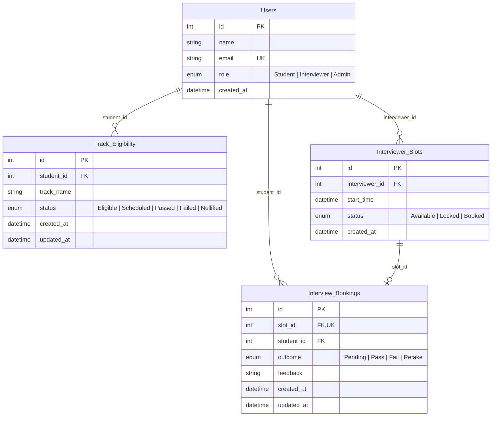

# GRIT Interview Scheduler 🎓

A modern, role-based web application for engineering students to book track badge interviews, interviewers to manage schedule availability and log evaluation outcomes, and administrators to oversee cohort metrics and enforce academic integrity.

Built with clean, modern **Notion / Linear** design principles, Tailwind CSS conventions, and a relational **SQLite** backend with automated integrity validation.

---

## 🌟 Live Free Hosting Options

You can host and share this application online for **100% free** so anyone in the world can access it:

### Option A: Streamlit Community Cloud (Recommended — 1-Click Free Hosting)
1. Push this repository to your **GitHub** account:
   ```bash
   git init
   git add .
   git commit -m "Initial commit: GRIT Interview Scheduler"
   git branch -M main
   git remote add origin https://github.com/<your-username>/<your-repo-name>.git
   git push -u origin main
   ```
2. Go to **[share.streamlit.io](https://share.streamlit.io)** and log in with GitHub.
3. Click **"New app"** and configure:
   - **Repository:** `<your-username>/<your-repo-name>`
   - **Branch:** `main`
   - **Main file path:** `streamlit_app.py`
4. Click **"Deploy!"** — Your app will be live with a public URL in under 2 minutes!

---

### Option B: Render.com (Free Web Service for Flask App)
1. Push your repository to GitHub.
2. Sign up on **[render.com](https://render.com)** (Free Tier).
3. Click **"New +"** → **"Web Service"** → Connect your GitHub repository.
4. Render will automatically detect [`render.yaml`](file:///Users/bhushan/Documents/GRIP%20NXT%20Assignmnet/render.yaml) or you can set:
   - **Environment:** `Python 3`
   - **Build Command:** `pip install -r requirements.txt && python3 seed.py`
   - **Start Command:** `gunicorn app:app`
5. Click **"Create Web Service"**. Your app will be live at `https://<your-app>.onrender.com`.

---

### Option C: Vercel (Free Serverless Python)
1. Push your repository to GitHub.
2. Go to **[vercel.com](https://vercel.com)** and click **"Add New Project"**.
3. Import the repository (configured via [`vercel.json`](file:///Users/bhushan/Documents/GRIP%20NXT%20Assignmnet/vercel.json)).
4. Click **"Deploy"**.

---

## 🧭 Architecture & Role Views

The application provides three role-based views accessible via the top navigation segmented role switcher:

### 1. Student View (`Student`)
* **Progress Banner:** Displays `"AI Engineering Track: 100% Complete. You are eligible for your interview."` with verified module completion and progress dial.
* **Available Slots Grid:** Displays open interviewer slots (`status == Available`).
* **Booking Hold & Confirmation Modal:** Simulates a 5-minute hold locking the slot (`status = 'Locked'`). Confirming updates slot to `'Booked'`, creates an `Interview_Bookings` record, and updates student eligibility to `'Scheduled'`.
* **Exact Success Banner:** Displays verbatim:
  > *"You’re booked! Your AI Engineering Track Interview is confirmed for Thursday, Nov 14 at 4:30 PM IST. A calendar invitation with your meeting link has been sent to your email. Please join 5 minutes early with your camera and workspace ready."*
* **Dynamic "After Result" States:**
  * **Passed:** Celebratory confetti card + badge icon with exact text:
    > *"Congratulations! You have passed your Track Badge Interview. Your GRIT AI Systems Track Badge has been unlocked and verified on your public profile. [View Your Badge & Certificate]"*
  * **Retake:** Warning card with exact text:
    > *"Interview Outcome: Retake Required. Your interviewer has requested a retake on core architecture concepts. Your rebooking window will open on Nov 21, 2026 (7-day preparation window). Review your feedback notes here: [View Detailed Notes]."*
  * **Nullified:** **Overwrites the entire dashboard** with a red, locked lockout screen stating:
    > *"Badge Nullified: Violation of academic integrity detected. All credentials have been revoked."*

---

### 2. Interviewer View (`Interviewer`)
* **Section 1: Manage Availability:**
  * Add new `Interviewer_Slots` via datetime picker (defaults to `'Available'`).
  * Quick slot shortcuts (*Tomorrow 10:00 AM*, *02:00 PM*, *03:30 PM*).
  * Real-time grid of published slots with delete functionality.
* **Section 2: Daily Queue & Outcomes:**
  * Displays confirmed student bookings for the evaluator.
  * Clicking **"Submit Evaluation"** opens evaluation dialog with Outcome dropdown (`Pass`, `Fail`, `Retake`) and feedback textarea.
  * **Crucial Eligibility Transitions:**
    * `Pass` → Updates `Track_Eligibility.status` to **`Passed`**.
    * `Fail` → Updates `Track_Eligibility.status` to **`Failed`**.
    * `Retake` → Crucially resets `Track_Eligibility.status` back to **`Eligible`**.

---

### 3. Admin / Operations View (`Admin`)
* **Dashboard Metrics:**
  * **Total Eligible (Unbooked)** vs **Total Scheduled**.
  * Badges Issued (`Passed`) and Academic Malpractice Flags (`Nullified`).
* **Student Cohort Registry:**
  * Complete data table listing all students, their tracks, and eligibility status.
* **Flag Malpractice Action:**
  * Highly visible red button on each student row.
  * Sets that student's `Track_Eligibility.status` to **`Nullified`** and revokes credentials.

---

## 🗄️ Database Schema & Relational Model



---

## 💻 Local Quickstart

### Prerequisites
* Python 3.10+ installed
* SQLite 3 (standard in Python)

### 1. Clone & Install
```bash
git clone https://github.com/<your-username>/<your-repo-name>.git
cd "GRIP NXT Assignmnet"
pip install -r requirements.txt
```

### 2. Initialize Database & Seed Dummy Data
```bash
python seed.py
```

### 3. Run Web Application
* **Option 1 (Full Flask Web App with Tailwind CSS & Custom Modals):**
  ```bash
  python app.py
  # Open http://127.0.0.1:5001
  ```
* **Option 2 (Streamlit App):**
  ```bash
  streamlit run streamlit_app.py
  # Open http://localhost:8501
  ```

---

## 🧪 Automated Test Suite (23/23 Tests Passing)

Run all unit and integration test suites:

```bash
# 1. Database schema, constraints, cascades & enums (9 tests)
python test_db.py

# 2. Student dashboard, hold locking, booking transaction & success banner (4 tests)
python test_booking_flow.py

# 3. Interviewer availability, daily queue & crucial status transitions (5 tests)
python test_interviewer_outcomes.py

# 4. Admin metrics, malpractice flagging & dynamic after-result states (5 tests)
python test_admin_and_dynamic_states.py
```

Or run all in one command:
```bash
python test_db.py && python test_booking_flow.py && python test_interviewer_outcomes.py && python test_admin_and_dynamic_states.py
```

---

## 📁 Repository Structure

```
.
├── .gitignore                      # Git ignore rules for virtual environments, OS files & caches
├── Procfile                        # Production WSGI process definition (Render / Heroku)
├── README.md                       # Comprehensive documentation & deployment guide
├── render.yaml                     # Render.com Infrastructure-as-Code configuration
├── vercel.json                     # Vercel serverless deployment configuration
├── runtime.txt                     # Target Python version pin
├── requirements.txt                # Production dependencies (Flask, Gunicorn, Streamlit)
├── schema.sql                      # ANSI SQL DDL schema with check constraints & foreign keys
├── seed.sql                        # Dynamic SQL seed script for test data
├── grit_scheduler.db               # SQLite relational database
├── db.py                           # Relational database access layer & transactions
├── models.py                       # Python dataclasses & Enums
├── types.ts                        # TypeScript interface definitions
├── seed.py                         # CLI database reset & summary script
├── app.py                          # Flask web application & REST API
├── streamlit_app.py                # 1-Click Streamlit Community Cloud application
├── templates/
│   └── index.html                  # Responsive Tailwind UI (Linear / Notion aesthetic)
├── test_db.py                      # Prompt 1 schema test suite
├── test_booking_flow.py            # Prompt 2 student booking test suite
├── test_interviewer_outcomes.py    # Prompt 3 interviewer outcome test suite
└── test_admin_and_dynamic_states.py# Prompt 4 & 5 admin & dynamic states test suite
```

---

## 🛡️ License & Academic Integrity
Built for educational credential verification and track badge defense evaluation under the GRIT Academic Framework.
